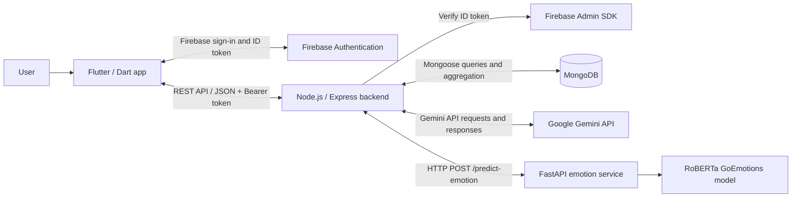

# MindSphere

MindSphere is a student software engineering project for personal mental wellness. It lets an authenticated user record mood and journal entries, chat with a wellness companion, complete PHQ-9 and GAD-7 screenings, view wellness summaries, and browse therapist recommendations.

> MindSphere provides general wellness support. It is not a medical diagnosis, treatment, therapist, or emergency service.

## Contents

- [Project status](#project-status)
- [Architecture](#architecture)
- [Implemented features](#implemented-features)
- [Repository layout](#repository-layout)
- [Requirements](#requirements)
- [Configuration](#configuration)
- [Run locally](#run-locally)
- [API overview](#api-overview)
- [Demo data](#demo-data)
- [Tests](#tests)
- [Diagrams](#diagrams)
- [Privacy and secrets](#privacy-and-secrets)
- [Known limitations](#known-limitations)

## Project status

This repository contains a Flutter client, a Node.js/Express API, and a separately run Python emotion inference service. The proposal describes additional features that are not implemented here. This README documents the source code as it exists, not every planned proposal feature.

## Architecture



The Flutter app obtains Firebase ID tokens and includes them in protected API requests. The Express middleware verifies tokens with Firebase Admin. Controllers scope user-owned records using the verified Firebase UID. Mongoose stores and queries MongoDB documents. AI calls are made by the backend; the Flutter app does not receive the Gemini API key.

## Implemented features

- Email/password signup and login with Firebase Authentication, email verification, and MongoDB profile synchronization.
- Profile name and preferences: notifications flag, preferred check-in time, and theme.
- Mood check-ins for mood, stress, energy, sleep, social connection, and an optional note; weekly mood summaries.
- Journal entry create, list, read, delete, and AI reflection/analysis.
- AI companion chat with recent conversation context and a backend keyword-based safety response.
- PHQ-9 and GAD-7 screening submissions, scores, result levels, and assessment history.
- Weekly and monthly wellness reports computed from mood, journal, and assessment records.
- Therapist directory filters and rule-based recommendations using recent assessment type, optional focus/location/language, therapist rating, and availability.
- Optional RoBERTa emotion inference for mood and journal analysis, with Gemini-based paths and fallback behavior in the backend.

## Repository layout

```text
.
├── backend/
│   ├── server.js                  # Express startup and route mounting
│   ├── src/
│   │   ├── config/                # MongoDB and Firebase Admin setup
│   │   ├── routes/                # HTTP route definitions
│   │   ├── controllers/           # Validation, workflow logic, responses
│   │   ├── middleware/            # Firebase token verification
│   │   ├── models/                # Mongoose schemas/models
│   │   ├── services/              # Gemini and emotion service clients
│   │   ├── utils/                 # Assessment scoring and safety helpers
│   │   └── scripts/               # Optional data seeders
│   └── test/                      # Node tests
├── emotion_service/
│   ├── app.py                     # FastAPI health and inference endpoints
│   ├── emotion_model.py           # RoBERTa GoEmotions inference
│   └── requirements.txt           # Currently empty; see setup instructions
├── frontend/
│   ├── lib/pages/                 # Flutter screens
│   ├── lib/services/              # Firebase auth and API client
│   ├── lib/config/                # API base URL selection
│   └── scripts/run-phone.ps1      # Android phone USB/ADB helper
├── MindSphere_AI_Integration.drawio
└── MindSphere_Component_Diagram.drawio
```

## Requirements

- Node.js 18 or newer and npm for the backend.
- Flutter SDK and Dart SDK for the client.
- Python 3.10 or newer is recommended for the emotion service.
- A MongoDB database/connection URI.
- A Firebase project with Email/Password Authentication enabled and client configuration for the Flutter targets you use.
- A Google Gemini API key for Gemini-backed features.
- Internet access when the emotion model is first loaded; Transformers downloads the configured model if it is not already cached.

The Python `emotion_service/requirements.txt` file is currently empty. Install the service's imported packages manually as shown below, or add a pinned requirements file as a separate project change.

## Configuration

Create `backend/.env` (do not commit it) with the settings your environment needs:

```dotenv
MONGODB_URI=<your MongoDB connection URI>
GEMINI_API_KEY=<your Gemini API key>
# Optional; defaults are shown here for reference.
PORT=5000
GEMINI_MODEL=gemini-3.5-flash-lite
GEMINI_FALLBACK_MODEL=gemini-3.6-flash
EMOTION_SERVICE_URL=http://127.0.0.1:8000
# Optional comma-separated browser origins.
CORS_ORIGINS=http://localhost:3000,http://localhost:5000
```

`backend/server.js` loads `.env` from the backend working directory. Firebase Admin initializes through Application Default Credentials. Set up credentials for your Firebase project in your local development environment; do not add service-account keys to Git.

The Flutter client initializes Firebase using the checked-in `frontend/lib/firebase_options.dart`. For a different Firebase project or target, configure the Flutter app with your project's Firebase client settings. The API address can be supplied at build/run time with `API_BASE_URL`; otherwise Android uses `http://10.0.2.2:5000/api` and other local targets use `http://localhost:5000/api`.

Optional settings used only by the demo-data script:

- `DEMO_USER_ID`: Firebase UID that should own the demo records.
- `DEMO_USER_EMAIL`: optional email cross-check for that UID.

## Run locally

Run each service in its own terminal from the repository root.

### 1. Start the emotion service

```bash
cd emotion_service
python -m venv .venv
```

Activate the virtual environment, then install its current imports:

```bash
# macOS / Linux
source .venv/bin/activate
python -m pip install fastapi uvicorn torch transformers
```

```powershell
# Windows PowerShell
.\.venv\Scripts\Activate.ps1
python -m pip install fastapi uvicorn torch transformers
```

Start the API (from `emotion_service/`):

```bash
uvicorn app:app --host 127.0.0.1 --port 8000
```

The backend expects the service at `http://127.0.0.1:8000` by default. If it runs elsewhere, set `EMOTION_SERVICE_URL` in `backend/.env`. The model and tokenizer load during service startup and may take time on first run.

### 2. Start the backend

Configure `backend/.env`, then:

```bash
cd backend
npm install
npm run dev
```

For a normal start, use `npm start`. The API listens on port 5000 by default and connects to MongoDB before listening. Check `http://localhost:5000/api/health` for the health response.

### 3. Start the Flutter app

```bash
cd frontend
flutter pub get
flutter run
```

For an Android emulator, the default API address uses `10.0.2.2`. For web, desktop, and the iOS simulator, the default is `localhost`. A physical Android phone needs a reachable backend address. The repository includes `frontend/scripts/run-phone.ps1` for USB/ADB port forwarding on Windows; see [frontend/README.md](frontend/README.md) for the phone instructions and network troubleshooting.

To pass a different API address explicitly:

```bash
flutter run --dart-define=API_BASE_URL=http://localhost:5000/api
```

Use an HTTPS API URL for production builds. Do not put backend credentials or the Gemini API key into Flutter build definitions.

## API overview

Except for health and the temporary emotion test route, the routes below use Firebase Bearer-token authentication. Requests and responses use JSON.

| Method | Path | Purpose |
|---|---|---|
| `GET` | `/api/health` | Backend health check |
| `POST` | `/api/auth/sync` | Create or synchronize a user profile |
| `GET` | `/api/auth/me` | Read current user's profile |
| `PUT` | `/api/auth/me` | Update profile/preferences |
| `POST` | `/api/moods` | Create mood check-in |
| `GET` | `/api/moods` | List mood entries |
| `GET` | `/api/moods/weekly` | Get weekly mood summary |
| `POST` | `/api/moods/:id/analyze` | Analyze a saved mood entry |
| `POST` | `/api/journals` | Create journal entry |
| `GET` | `/api/journals` | List journal entries |
| `GET` | `/api/journals/:id` | Read one owned journal entry |
| `DELETE` | `/api/journals/:id` | Delete one owned journal entry |
| `GET` | `/api/assessments` | List PHQ-9/GAD-7 assessment definitions |
| `POST` | `/api/assessments/submit` | Score and save an assessment |
| `GET` | `/api/assessments/history` | Read assessment history |
| `POST` | `/api/ai/chat` | Get an AI companion response |
| `POST` | `/api/ai/journal-analysis` | Analyze a saved journal entry |
| `GET` | `/api/ai/weekly-insight` | Generate a weekly AI wellness insight |
| `GET` | `/api/reports/weekly` | Get aggregated weekly report |
| `GET` | `/api/reports/monthly` | Get aggregated current-month report |
| `GET` | `/api/therapists` | List active therapists; supports filters |
| `GET` | `/api/therapists/recommended` | Get ranked recommendations |
| `GET` | `/api/therapists/:id` | Read active therapist details |
| `GET` | `/api/test-emotion?text=...` | Temporary backend emotion-service diagnostic route |

The Python emotion service exposes `GET /health` and `POST /predict-emotion` with a JSON body containing `text`.

## AI integration behavior

- **Chat:** The backend checks a fixed list of crisis-related phrases. A match returns a prepared safety response; otherwise recent chat history and the message are sent to Gemini. The exchange is stored in `ChatHistory`.
- **Journal analysis:** The backend checks for crisis language first. Otherwise, it uses Gemini or, if the trained-model mode is requested, the emotion service and Gemini reflection. The analysis is stored on the journal document.
- **Mood analysis:** Gemini can analyze the submitted ratings and note. The trained-model path uses the emotion service on a nonempty note, then Gemini to write an insight. The backend has fallback behavior for model/AI failures.
- **Weekly reports:** `/api/reports/weekly` and `/monthly` aggregate MongoDB data and do not call Gemini. `/api/ai/weekly-insight` is a separate AI-backed endpoint.
- **Safety scope:** The keyword check is not a clinical risk assessment and cannot guarantee detection of every crisis message. AI output is general wellness information and is not a substitute for professional or emergency care.

## Demo data

The optional `seed:demo` script creates clearly marked demo mood entries, journal entries, assessments, and fictional therapist profiles for one existing Firebase account. It verifies the Firebase UID and can optionally check the email. It replaces only prior records marked as demo for that user; review the script before running it against any database.

From `backend/`, after setting the demo environment variables:

```bash
npm run seed:demo
```

## Tests

The repository includes a Node test script (`npm test` from `backend/`) and a Flutter test target (`flutter test` from `frontend/`). `emotion_service/test_model.py` is a sample inference script that loads the model and prints predictions; it is not a pytest suite.

## Diagrams

- [AI integration diagram](MindSphere_AI_Integration.drawio)
- [Component diagram](MindSphere_Component_Diagram.drawio)

Open either `.drawio` file in [diagrams.net](https://app.diagrams.net/) to view or edit it.

## Privacy and secrets

- Never commit `backend/.env`, Firebase service-account credentials, API keys, database URIs, or personal user data.
- Keep Gemini credentials on the backend; do not ship them in the Flutter application.
- Chat and journal text, and mood notes submitted for AI analysis, are sent from the backend to the configured AI provider. Avoid using real sensitive personal information in demonstrations and use demo data where possible.
- Therapist seed/demo profiles are fictional and should not be represented as real providers.

## Known limitations

- There is no implemented admin dashboard/role system, appointment booking, therapist account, real-time video consultation, hospital integration, notifications scheduler, habits module, meditation library, or Cloudinary integration.
- Only PHQ-9 and GAD-7 are implemented; the proposed stress assessment is not present.
- Therapist recommendations use application scoring rules and available profile fields; there is no review-text analysis or Gemini-based therapist matcher.
- There is no verified production deployment/hosting configuration in this repository.
- The Python requirements file is empty; dependencies are currently described in the setup section above rather than pinned in that file.
