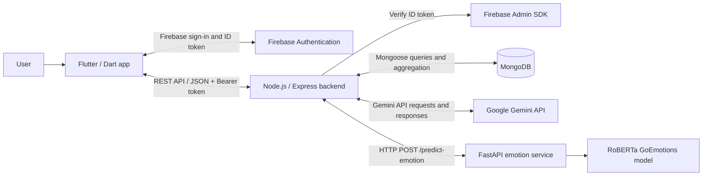

# MindSphere

<<<<<<< HEAD
> An AI-powered mental wellness app for students: mood tracking, journaling, an AI companion with built-in safety checks, PHQ-9 / GAD-7 screenings, and therapist recommendations.

## Overview

MindSphere is a mobile wellness application built with **Flutter** and a **Node.js / Express** backend. Users sign in with Firebase Authentication, record daily mood check-ins, write journal entries, chat with an AI companion, take standard screening questionnaires, and get matched with therapists.

AI features are powered by **Google Gemini**, with an optional **FastAPI + RoBERTa** emotion-classification service as a "trained model" analysis path. A crisis-keyword check runs in the backend so that high-risk messages receive a prepared safety-support reply instead of a generated one.

> **Disclaimer:** MindSphere is a wellness support tool, not a medical device. PHQ-9 / GAD-7 results are screening scores, not diagnoses. If you are in crisis, please contact local emergency services or a trusted professional.

## Features

- **Authentication & profile**: email/password sign-up, email verification, Firebase sign-in, profile and preference management (theme, check-in time, notifications)
- **Mood tracking**: daily check-ins (mood, stress, energy, sleep, social connection), history, weekly summaries, and optional AI analysis
- **Journaling**: write, view, delete, and analyze entries (emotion, summary, reflection)
- **AI companion**: chat with Gemini using recent chat history, with crisis-keyword detection and a prepared safety response
- **PHQ-9 / GAD-7 screening**: scoring, severity, saved history, and a disclaimer
- **Therapist recommendations**: browse and filter therapists, with rule-based ranking and match reasons
- **Wellness reports**: weekly and monthly aggregates
- **Dual analysis modes**: Gemini or a trained RoBERTa emotion model (with Gemini fallback)

## Tech Stack

| Layer | Technology |
|---|---|
| Presentation | Flutter / Dart |
| Application | Node.js / Express |
| Data | MongoDB (Mongoose) |
| Authentication | Firebase Authentication (ID token verification) |
| AI | Google Gemini API |
| Emotion classification | Python FastAPI + RoBERTa |

## Architecture

### Level 0: Context Diagram


### Level 0: Architectural Design


### Level 1: Architectural Design


### Level 2: Module Decomposition


### AI Integration


## Use Case Diagrams

### Authentication & Profile


### Mood Tracking & Reports


### AI Companion Chat


### Journal


### Assessments & Therapists


## Activity Diagrams

### Authentication Flow


### Mood / Journal Flow


### AI Chat Flow


### Assessment & Therapist Recommendation Flow


## Sequence Diagrams

### Mood Check-in & Analysis


### AI Chat


## Data Model

### Entity-Relationship Diagram


### Class Diagrams

**User and preferences**


**Mood and journal entries**


**Assessment, chat history, therapist, and Gemini service**


## Component Design

### User Management


### Mood & Journal Manager


### Assessment Support


### AI Companion


## Getting Started

> Replace the commands below with your project's actual folder names and scripts.

### Prerequisites

- Flutter SDK
- Node.js and npm
- MongoDB (local or Atlas)
- A Firebase project (Authentication enabled)
- A Google Gemini API key
- Python 3.9+ (only for the optional emotion service)

### Installation
=======
### Your personalized AI companion for mental wellness

**Flutter · Dart · Node.js · Express · MongoDB · Firebase · Google Gemini · FastAPI · RoBERTa**

MindSphere is a student software engineering project that helps people reflect on their emotional wellbeing. Users can track moods, write journal entries, chat with an AI wellness companion, complete mental-health screenings, review wellness summaries, and browse therapist recommendations.

> MindSphere provides general wellness support. It is not a medical diagnosis, treatment, therapist, or emergency service.

## Contents

- [System architecture](#system-architecture)
- [Key features and modules](#key-features-and-modules)
- [Project structure](#project-structure)
- [Local installation and quick start](#local-installation-and-quick-start)
- [API overview](#api-overview)
- [AI integration](#ai-integration)
- [Demo data](#demo-data)
- [Testing](#testing)
- [Privacy, safety, and limitations](#privacy-safety-and-limitations)

## System architecture

MindSphere consists of a Flutter client, a Node.js/Express REST API, and an optional Python emotion-inference service. This page describes implemented behavior; proposal-only features are not presented as available features.

### Component overview



The client sends Firebase-authenticated JSON requests to Express. The backend verifies tokens, applies application logic, and accesses MongoDB through Mongoose. It calls Gemini for generated wellness content and can call the FastAPI/RoBERTa service for emotion classification. AI credentials remain on the backend.

## Key features and modules

1. **Account and profile:** Email/password signup and login, email verification, profile synchronization, and profile preferences.
2. **Mood tracking:** Record mood, stress, energy, sleep, social connection, and an optional note. View mood history and weekly averages.
3. **Journal:** Create, read, list, and delete journal entries; request an AI reflection and emotion analysis.
4. **AI companion:** Chat with Gemini using recent conversation context. A backend keyword check can return a prepared safety response.
5. **Screening assessments:** Submit PHQ-9 or GAD-7 answers and view scores, result levels, and history.
6. **Wellness reports:** View weekly or monthly summaries aggregated from mood, journal, and assessment records.
7. **Therapist directory:** Filter profiles and view rule-based recommendations using assessment type, optional preferences, rating, and availability.
8. **Emotion inference:** Optionally classify journal or mood-note text with the RoBERTa GoEmotions service; the backend can use Gemini when the model path fails.

## Project structure

```text
.
├── backend/
│   ├── server.js                  # Express startup and route mounting
│   ├── src/
│   │   ├── config/                # MongoDB and Firebase Admin setup
│   │   ├── routes/                # HTTP route definitions
│   │   ├── controllers/           # Validation, workflow logic, responses
│   │   ├── middleware/            # Firebase token verification
│   │   ├── models/                # Mongoose schemas/models
│   │   ├── services/              # Gemini and emotion service clients
│   │   ├── utils/                 # Assessment scoring and safety helpers
│   │   └── scripts/               # Optional data seeders
│   └── test/                      # Node tests
├── emotion_service/
│   ├── app.py                     # FastAPI health and inference endpoints
│   ├── emotion_model.py           # RoBERTa GoEmotions inference
│   └── requirements.txt           # Currently empty; see setup instructions
├── frontend/
│   ├── lib/pages/                 # Flutter screens
│   ├── lib/services/              # Firebase auth and API client
│   ├── lib/config/                # API base URL selection
│   └── scripts/run-phone.ps1      # Android phone USB/ADB helper
```

## Local installation and quick start

### Prerequisites

- Node.js 18 or newer and npm for the backend.
- Flutter SDK and Dart SDK for the client.
- Python 3.10 or newer for the emotion service.
- A MongoDB database/connection URI.
- A Firebase project with Email/Password Authentication enabled and client configuration for the Flutter targets you use.
- A Google Gemini API key for Gemini-backed features.
- Internet access when the emotion model is first loaded; Transformers downloads the configured model if it is not already cached.

The Python `emotion_service/requirements.txt` file is currently empty. Install the service's imported packages manually as shown below.

### 1. Clone the repository
>>>>>>> 0c5e02bc111d60937a8f106d4c52c11293c918e4

```bash
git clone https://github.com/sharifa5852/MindSphere.git
cd MindSphere
```

<<<<<<< HEAD
**Backend**
```bash
cd backend
npm install
cp .env.example .env   # add your keys
npm start
```

**Emotion service (optional)**
```bash
cd emotion-service
pip install -r requirements.txt
uvicorn main:app --reload
```

**Mobile app**
```bash
cd app
=======
### Configuration

Create `backend/.env` (do not commit it) with the settings your environment needs:

```dotenv
MONGODB_URI=<your MongoDB connection URI>
GEMINI_API_KEY=<your Gemini API key>
# Optional; defaults are shown here for reference.
PORT=5000
GEMINI_MODEL=gemini-3.5-flash-lite
GEMINI_FALLBACK_MODEL=gemini-3.6-flash
EMOTION_SERVICE_URL=http://127.0.0.1:8000
# Optional comma-separated browser origins.
CORS_ORIGINS=http://localhost:3000,http://localhost:5000
```

`backend/server.js` loads `.env` from the backend working directory. Firebase Admin initializes through Application Default Credentials. Set up credentials for your Firebase project in your local development environment; do not add service-account keys to Git.

The Flutter client initializes Firebase using the checked-in `frontend/lib/firebase_options.dart`. For a different Firebase project or target, configure the Flutter app with your project's Firebase client settings. The API address can be supplied at build/run time with `API_BASE_URL`; otherwise Android uses `http://10.0.2.2:5000/api` and other local targets use `http://localhost:5000/api`.

Optional settings used only by the demo-data script:

- `DEMO_USER_ID`: Firebase UID that should own the demo records.
- `DEMO_USER_EMAIL`: optional email cross-check for that UID.

### 2. Start the emotion service

```bash
cd emotion_service
python -m venv .venv
```

Activate the virtual environment, then install its current imports:

```bash
# macOS / Linux
source .venv/bin/activate
python -m pip install fastapi uvicorn torch transformers
```

```powershell
# Windows PowerShell
.\.venv\Scripts\Activate.ps1
python -m pip install fastapi uvicorn torch transformers
```

Start the API (from `emotion_service/`):

```bash
uvicorn app:app --host 127.0.0.1 --port 8000
```

The backend expects the service at `http://127.0.0.1:8000` by default. If it runs elsewhere, set `EMOTION_SERVICE_URL` in `backend/.env`. The model and tokenizer load during service startup and may take time on first run.

### 3. Start the backend

Configure `backend/.env`, then:

```bash
cd backend
npm install
npm run dev
```

For a normal start, use `npm start`. The API listens on port 5000 by default and connects to MongoDB before listening. Check `http://localhost:5000/api/health` for the health response.

### 4. Start the Flutter app

```bash
cd frontend
>>>>>>> 0c5e02bc111d60937a8f106d4c52c11293c918e4
flutter pub get
flutter run
```

<<<<<<< HEAD
### Environment Variables

```
MONGODB_URI=
GEMINI_API_KEY=
FIREBASE_SERVICE_ACCOUNT=
EMOTION_SERVICE_URL=
```

## Project Structure

```
MindSphere/
├── app/                # Flutter application
├── backend/            # Node.js / Express API
├── emotion-service/    # FastAPI + RoBERTa (optional)
├── docs/
│   └── diagrams/       # Design diagrams used in this README
└── README.md
```

## Contributing

1. Fork the repository
2. Create a branch (`git checkout -b feature/your-feature`)
3. Commit your changes
4. Open a pull request

## License

Add your license here.

## Author

[@sharifa5852](https://github.com/sharifa5852)
=======
For an Android emulator, the default API address uses `10.0.2.2`. For web, desktop, and the iOS simulator, the default is `localhost`. A physical Android phone needs a reachable backend address. The repository includes `frontend/scripts/run-phone.ps1` for USB/ADB port forwarding on Windows; see [frontend/README.md](frontend/README.md) for the phone instructions and network troubleshooting.

To pass a different API address explicitly:

```bash
flutter run --dart-define=API_BASE_URL=http://localhost:5000/api
```

Use an HTTPS API URL for production builds. Do not put backend credentials or the Gemini API key into Flutter build definitions.

## API overview

The Express API serves JSON under `/api`. The main route groups are `/auth`, `/moods`, `/journals`, `/ai`, `/assessments`, `/reports`, and `/therapists`. Protected routes require a Firebase ID token in the Bearer authorization header. `GET /api/health` is available for checking the backend. The Python service exposes `GET /health` and `POST /predict-emotion`.

## AI integration

- **Chat:** The backend checks a fixed list of crisis-related phrases. A match returns a prepared safety response; otherwise recent chat history and the message are sent to Gemini. The exchange is stored in `ChatHistory`.
- **Journal analysis:** The backend checks for crisis language first. Otherwise, it uses Gemini or, if the trained-model mode is requested, the emotion service and Gemini reflection. The analysis is stored on the journal document.
- **Mood analysis:** Gemini can analyze the submitted ratings and note. The trained-model path uses the emotion service on a nonempty note, then Gemini to write an insight. The backend has fallback behavior for model/AI failures.
- **Weekly reports:** `/api/reports/weekly` and `/monthly` aggregate MongoDB data and do not call Gemini. `/api/ai/weekly-insight` is a separate AI-backed endpoint.
- **Safety scope:** The keyword check is not a clinical risk assessment and cannot guarantee detection of every crisis message. AI output is general wellness information and is not a substitute for professional or emergency care.

## Demo data

The optional `seed:demo` script creates sample mood entries, journal entries, assessments, and fictional therapist profiles for an existing Firebase account. It verifies the Firebase UID and can optionally check the email. Review `backend/src/scripts/seedDemoData.js` before running it against a database: the script uses `isDemo` markers for wellness records, but those fields are not declared in their Mongoose schemas, so repeated runs may not identify prior records reliably. Therapist demo profiles use a `seedSource` marker.

From `backend/`, after setting the demo environment variables:

```bash
npm run seed:demo
```

## Testing

The repository currently contains:

- **Backend unit tests:** Two tests for PHQ-9 and GAD-7 score calculation, severity levels, and support flags (`backend/test/assessmentScoring.test.js`).
- **Flutter widget test:** Checks that the welcome screen shows login and account-creation actions and builds without a widget exception (`frontend/test/widget_test.dart`).
- **Emotion-model sample run:** `emotion_service/test_model.py` sends four example sentences through the model and prints predictions. It is a smoke/demo script, not an automated test suite because it has no assertions.

Run the automated test suites from their project folders:

```bash
cd backend
npm test

cd ../frontend
flutter test
```

There are no API/database integration, full-system, acceptance, load, or security test suites in the repository. Do not describe those as completed unless you performed and recorded them separately.

## Privacy, safety, and limitations

- Never commit `backend/.env`, Firebase service-account credentials, API keys, database URIs, or personal user data.
- Keep Gemini credentials on the backend; do not ship them in the Flutter application.
- Chat and journal text, and mood notes submitted for AI analysis, are sent from the backend to the configured AI provider. Avoid using real sensitive personal information in demonstrations and use demo data where possible.
- Therapist seed/demo profiles are fictional and should not be represented as real providers.

- The proposal's admin panel, stress assessment, notifications, meditation, video consultation, and review analysis are not implemented. Only PHQ-9 and GAD-7 screenings are available.
- Therapist recommendations use application scoring rules; they do not analyze review text or use Gemini.
- No production deployment configuration is included. The Python requirements file is empty, so emotion-service dependencies are not pinned.
>>>>>>> 0c5e02bc111d60937a8f106d4c52c11293c918e4
